# 🚀 Awesome Programming Languages

### 🔬 Curated Directory of Technical, Numerical, Statistical & Symbolic Computing Ecosystems

  
  
  
  
  
  
  
  

  <b>A comprehensive, SEO-optimized index tracking commercial SaaS workbenches, mathematical environments, and high-performance open-source runtimes for technical computing.</b> 
  <i>Matrix-First Languages • Statistical Analysis • Computer Algebra Systems (CAS) • Differential Equations • High-Performance Computing (HPC)</i>

---

## 📑 Table of Contents

- [🌟 Overview & SEO Taxonomy](#-overview--seo-taxonomy)
- [🌐 Sector Overview & Market Dynamics](#-sector-overview--market-dynamics)
- [💼 Commercial & SaaS Platforms (Sorted by Company Size)](#-commercial--saas-platforms-sorted-by-company-size)
- [🔓 Open-Source GitHub Projects (Sorted by Stars)](#-open-source-github-projects-sorted-by-stars)
- [📊 Ecosystem Architectural Comparison](#-ecosystem-architectural-comparison)
- [🤝 How to Contribute](#-how-to-contribute)
- [⭐ Star History](#-star-history)
- [💖 Support & Sponsoring](#-support--sponsoring)
- [⚠️ Disclaimer](#️-disclaimer)

---

## 🌟 Overview & SEO Taxonomy

Technical computing relies on specialized language architectures designed for matrix transformations, high-dimensional tensor operations, symbolic mathematical manipulations, and rigorous statistical hypothesis testing. This repository catalogs both enterprise SaaS suites and community-driven open-source runtimes across five core computational disciplines:

1. **Numerical Computing & Array Runtimes**: Vectorized memory layouts, BLAS/LAPACK hardware bindings, automatic differentiation, and multi-threaded linear algebra (e.g., MATLAB, Julia, NumPy, Mojo).
2. **Statistical Computing & Biostatistics**: Maximum likelihood estimation, survival analysis, econometrics, clinical submission suites (CDISC/SDTM/ADaM), and survey data processing (e.g., SAS, R, Stata, SPSS, JMP).
3. **Computer Algebra Systems (CAS) & Symbolic Mathematics**: Exact algebraic reduction, arbitrary-precision arithmetic, symbolic integration, Gröbner bases, and mathematical knowledge graphs (e.g., Wolfram Mathematica, Maple, SageMath, Maxima, SymPy).
4. **Interactive Theorem Proving & Formal Verification**: Dependent type theory, mathematical proof verification, and constructive logic (e.g., Lean 4).
5. **High-Performance Simulation & GPU Kernels**: Native ahead-of-time (AOT) and just-in-time (JIT) compiled engines for multiphysics, ODE/PDE solving, and real-time graphics simulation (e.g., Rust, Taichi, LLVM Flang Fortran).

---

## 🌐 Sector Overview & Market Dynamics

The global scientific computing, engineering simulation, and statistical software market is currently valued at approximately **$18 billion to $24 billion**, expanding at a 7–10% compound annual growth rate (CAGR) driven by AI/ML integration, biopharmaceutical clinical pipelines, and industrial digital twins. 

The sector displays a **moderately concentrated, bifurcated market structure**:
- **Commercial Enterprise Monopolies & Regulatory Moats**: Sub-sectors such as automotive/aerospace model-based engineering (MathWorks MATLAB/Simulink) and regulatory pharmaceutical drug trials (SAS Institute) exhibit high concentration with powerful vendor lock-in. Established validation procedures (e.g., FDA submission history, AS9100 safety compliance) and massive legacy codebases create high barrier-to-entry "winner-take-all" moats.
- **Open-Source Scientific Hegemony**: Concurrently, academic research, frontier machine learning, and cloud-native analytics are overwhelmingly dominated by open ecosystems (Python, R, Julia, Rust). Rather than displacing commercial giants entirely, this dynamic has forced enterprise vendors into hybrid strategies—introducing browser-accessible SaaS tiers, Python API bridges, Jupyter kernels, and usage-based cloud licensing.

---

## 💼 Commercial & SaaS Platforms (Sorted by Company Size)

The following table catalogs the leading commercial environments, ranked in **descending order by company valuation or annual revenue**. All pricing reflects verifiable commercial entry tiers, and free tier limits specify exact operational parameters.

| Rank | Product / Platform | Company Valuation / Revenue | Starting Commercial Pricing | Free Tier / Trial Limits | Core Focus & Enterprise Niche |
| :---: | :--- | :--- | :--- | :--- | :--- |
| **01** | **[IBM SPSS Statistics](https://www.ibm.com/products/spss-statistics)** | **$210B+ Market Cap** *(IBM, NYSE: IBM)* | **$109.00 / user / month** *(Base Subscription, billed monthly)* | **14-day free trial** • Full access to Base features & core add-ons • Restricted to 1 IBMid per user/year • 1 concurrent seat, non-production | Menu-driven and syntax statistical workbench widely adopted across social sciences, healthcare research, psychology, and enterprise survey analytics. |
| **02** | **[PTC Mathcad Prime](https://www.ptc.com/en/products/mathcad)** | **$22B+ Market Cap** *(PTC Inc., NASDAQ: PTC)* | **$859.00 / user / year** *(Locked Individual Subscription)* | **30-day full-featured trial** • Automatically converts into **Mathcad Express** (free forever) • Express limits: basic calculations & 2D plots only; no symbolics or programming | Digital engineering notebook combining human-readable live mathematical notation, automatic unit consistency checking, and CAD/FEA engineering workflows. |
| **03** | **[SAS Analytics Pro & SAS Viya](https://www.sas.com/)** | **$16B Valuation** *(SAS Institute, ~$3.2B Rev)* | **$0.55 / core-hour** *(Viya Cloud)* or **~$8,500.00 / user / year** *(Desktop)* | **SAS OnDemand for Academics** • Free forever for non-commercial learning • 5 GB cloud storage limit, shared server pool • 14-day SAS Viya cloud sandbox trial for businesses | Gold standard enterprise statistical analysis platform entrenched in CDISC SDTM/ADaM clinical trials, regulatory submissions, banking risk, and credit scoring. |
| **04** | **[MATLAB](https://www.mathworks.com/products/matlab.html)** | **$12B Valuation** *(MathWorks, ~$1.5B Rev)* | **$940.00 / user / year** *(Standard Annual Lease; $2,150 perpetual)* | **30-day free trial** • Full desktop & MATLAB Online access • Includes Simulink & 80+ specialized engineering and signal toolboxes | Dominant matrix-first computing environment with hardware-in-the-loop control, DSP toolboxes, and Simulink model-based systems engineering. |
| **05** | **[JMP Statistical Software](https://www.jmp.com/)** | **$1.2B Valuation** *(JMP LLC / SAS Spin-off, ~$180M Rev)* | **$1,540.00 / user / year** *(JMP Standard Annual Subscription)* | **30-day free trial** • Unrestricted access to standard visual analytics • Restricted to 1 machine per user, no credit card required | Highly interactive visual statistical discovery tool, standard in Six Sigma quality engineering, semiconductor yield optimization, and industrial DOE. |
| **06** | **[Posit Workbench & Cloud](https://posit.co/)** | **$1.05B Valuation** *(Posit PBC, ~$65M ARR)* | **$5.00 / user / month** *(Posit Cloud)* or **$990.00 / user / year** *(Workbench)* | **Posit Cloud Free Tier** • Free forever plan with 25 compute hours/month • 1 GB RAM, 1 shared CPU, 25 project limit • 45-day Posit Workbench enterprise evaluation | Unified enterprise data science server platform providing governed collaborative instances of RStudio IDE, JupyterLab, and VS Code for R and Python teams. |
| **07** | **[Wolfram Mathematica](https://www.wolfram.com/mathematica/)** | **$600M Valuation** *(Wolfram Research, ~$90M Rev)* | **$152.00 / user / month** *(Cloud)* or **$2,242.00 / year** *(Wolfram\|One)* | **15-day free trial** • Full desktop Mathematica & Wolfram Cloud access • **Wolfram Cloud Basic**: free forever with 0.2 GB storage and 20 monthly cloud credits | Premier symbolic mathematics computation engine powered by the Wolfram Language, featuring world-leading algorithms for symbolic integration and CAS. |
| **08** | **[Stata](https://www.stata.com/)** | **$300M Valuation** *(StataCorp LLC, ~$40M Rev)* | **$225.00 / user / year** *(Stata/BE Basic Edition commercial)* | **30-day evaluation license** • Granted upon request through sales/distributors • Single-user authorization, full BE features, non-production | Integrated econometrics workbench specialized in panel data models, survival analysis, instrumental variables, survey sampling, and reproducible research. |
| **09** | **[Maplesoft Maple](https://www.maplesoft.com/)** | **$250M Parent Market Cap** *(Cybernet Systems, ~$45M Rev)* | **$1,490.00 / user / year** *(Commercial Lease; $2,990 perpetual)* | **15-day free trial** • Unrestricted symbolic and numeric math engine • Standalone activation key, no credit card required | Symbolic and numeric calculation environment popular in physics and mechanical engineering with native physical unit enforcement and differential equation tools. |
| **10** | **[OriginLab Origin](https://www.originlab.com/)** | **$150M Valuation** *(OriginLab Corp, ~$25M Rev)* | **$650.00 / user / year** *(Standard Commercial Lease; $1,195 perpetual)* | **21-day free evaluation** • Full feature set with licensed trial key (or 3-day unreg) • Demo watermark on exported graphs, max 30 sheets/project | Scientific publication-quality 2D/3D graphing and technical analysis software, recognized as an industry standard for spectroscopy and peak deconvolution. |

---

## 🔓 Open-Source GitHub Projects (Sorted by Stars)

The following repositories represent the open-source foundations of modern technical computing. Repositories are strictly sorted in **descending order by GitHub stargazers count**. Each entry features an interactive star badge directly linking to the repository's stargazers page.

### 1. **[Rust](https://github.com/rust-lang/rust)** 
- **License**: MIT / Apache-2.0
- **Ecosystem Role**: High-performance systems programming language providing memory safety without garbage collection.
- **Scientific Impact**: Increasingly used to write blazingly fast numerical foundations, SIMD-accelerated array libraries (e.g., `ndarray`), BLAS/LAPACK bindings, and memory-safe physics engines. Acts as the high-speed backend for Python and Julia extensions.

### 2. **[Python (Scientific Stack)](https://github.com/python/cpython)** 
- **License**: Python Software Foundation (PSF) License
- **Ecosystem Role**: The general-purpose language with the world's largest scientific, AI, and data engineering ecosystem.
- **Scientific Impact**: Underpins modern machine learning and data science through NumPy, SciPy, pandas, and PyTorch. Known trade-off: ecosystem fragmentation across competing array types (NumPy vs. PyTorch vs. JAX) and symbolic incompatibilities (SymPy objects vs. primitive numeric buffers).

### 3. **[Julia](https://github.com/JuliaLang/julia)** 
- **License**: MIT License
- **Ecosystem Role**: High-performance dynamic language designed specifically for technical, numerical, and scientific computing.
- **Scientific Impact**: Solves the notorious "two-language problem" by compiling dynamic code to LLVM machine code at C-like speed via multiple dispatch. Native differential equation solving (`DifferentialEquations.jl`), unified symbolic-numeric modeling (`ModelingToolkit.jl`), and seamless automatic differentiation.

### 4. **[NumPy](https://github.com/numpy/numpy)** 
- **License**: BSD-3-Clause
- **Ecosystem Role**: The universal N-dimensional array standard for numerical computing in Python.
- **Scientific Impact**: Provides contiguous memory striding, vectorized broadcasting, and C/Fortran API integration. All major Python data and ML frameworks depend directly on NumPy array protocols.

### 5. **[Mojo](https://github.com/modular/modular)** 
- **License**: Modular Community License / Open Source Components
- **Ecosystem Role**: A new programming language bridging the simplicity of Python with the hardware performance of C++ and MLIR.
- **Scientific Impact**: Built by the creators of LLVM and Swift to accelerate AI systems, high-throughput numerical modeling, and heterogeneous GPU/CPU tensor hardware execution.

### 6. **[Taichi](https://github.com/taichi-dev/taichi)** 
- **License**: Apache-2.0
- **Ecosystem Role**: Domain-specific language embedded in Python for high-performance, parallel physical simulation and computer graphics.
- **Scientific Impact**: JIT-compiles Python-like code into multi-threaded CPU instructions and GPU kernels (CUDA, Metal, Vulkan), making material point methods, fluid dynamics, and grid simulations accessible without C++/CUDA boilerplate.

### 7. **[Nim](https://github.com/nim-lang/Nim)** 
- **License**: MIT License
- **Ecosystem Role**: Statically typed compiled systems language combining Python-like expressiveness with C++ execution performance.
- **Scientific Impact**: Highly suitable for scientific modeling, deterministic memory management without garbage collection pauses (ARC/ORC), and matrix mathematics via libraries like `arraymancer`.

### 8. **[SciPy](https://github.com/scipy/scipy)** 
- **License**: BSD-3-Clause
- **Ecosystem Role**: Core scientific library providing fundamental algorithms for mathematics, science, and engineering in Python.
- **Scientific Impact**: Implements numerical integration (`scipy.integrate`), continuous/discrete optimization (`scipy.optimize`), signal processing, Fourier transforms, eigenvalue solvers, and statistical probability distributions.

### 9. **[SymPy](https://github.com/sympy/sympy)** 
- **License**: BSD-3-Clause
- **Ecosystem Role**: Full-featured computer algebra system (CAS) written in pure Python.
- **Scientific Impact**: Capable of symbolic integration, algebraic equation solving, calculus, discrete mathematics, and quantum mechanics calculations. Achieves over 95.1% integration success rates in benchmark testing without external proprietary C-runtimes.

### 10. **[Lean 4](https://github.com/leanprover/lean4)** 
- **License**: Apache-2.0
- **Ecosystem Role**: Interactive theorem prover and pure functional programming language based on the Calculus of Inductive Constructions.
- **Scientific Impact**: Rapidly becoming the global foundation for formalized mathematics (e.g., the *Mathlib* project), verified software development, and AI-assisted automated reasoning in pure mathematics.

### 11. **[Racket](https://github.com/racket/racket)** 
- **License**: Apache-2.0 / MIT
- **Ecosystem Role**: General-purpose, multi-paradigm programming language in the Lisp/Scheme family with industrial language-oriented programming facilities.
- **Scientific Impact**: Heavily utilized for programming language research, symbolic computation, macros, domain-specific languages (DSLs), and algebraic logic modeling.

### 12. **[Glasgow Haskell Compiler (GHC)](https://github.com/ghc/ghc)** 
- **License**: BSD-3-Clause
- **Ecosystem Role**: The premier state-of-the-art native compiler and interactive environment for the purely functional language Haskell.
- **Scientific Impact**: Widely employed in mathematical computing, type-driven scientific workflows, financial quantitative analysis, category theory implementations, and compiler research.

### 13. **[DifferentialEquations.jl](https://github.com/SciML/DifferentialEquations.jl)** 
- **License**: MIT License
- **Ecosystem Role**: High-performance multi-paradigm differential equation solver suite written in Julia.
- **Scientific Impact**: Outperforms classic Fortran/C ODE/DAE suites (Hairer, Sundials) across stiff and non-stiff ordinary differential equations, stochastic differential equations (SDEs), and scientific machine learning (SciML) neural ODE integrations.

### 14. **[SageMath](https://github.com/sagemath/sage)** 
- **License**: GPL-3.0
- **Ecosystem Role**: Giant open-source mathematics software system integrating dozens of specialized packages behind a Python interface.
- **Scientific Impact**: Serves as the open-source alternative to Mathematica, uniting Maxima (calculus), Pari/GP (number theory), GAP (group theory), Singular (polynomials), and NumPy under a single coherent syntax.

### 15. **[R (R-Source)](https://github.com/wch/r-source)** 
- **License**: GPL-2.0 / GPL-3.0
- **Ecosystem Role**: The definitive programming language and environment for statistical computing, data analysis, and publication graphics.
- **Scientific Impact**: Hosts over 20,000 strictly vetted CRAN packages. Mainstay of academic statistics, bioinformatics (Bioconductor), and pharmaceutical clinical trials via the open Pharmaverse ecosystem (Roche, GSK, Novartis, J&J).

### 16. **[Flang (LLVM Fortran)](https://github.com/flang-compiler/flang)** 
- **License**: Apache-2.0 with LLVM Exceptions
- **Ecosystem Role**: Modern Fortran front-end designed for integration with the LLVM compiler infrastructure.
- **Scientific Impact**: Modernizes legacy scientific computing and supercomputing codes. Fortran continues to power global climate forecasting models, computational fluid dynamics (CFD), and atomic simulations on top supercomputers.

### 17. **[GNU Octave](https://github.com/gnu-octave/octave)** 
- **License**: GPL-3.0
- **Ecosystem Role**: High-level language primarily intended for numerical computations with syntax mostly compatible with MATLAB.
- **Scientific Impact**: Enables researchers, educators, and engineers to execute MATLAB-syntax m-files and scripts in headless server containers or Linux clusters without proprietary license fees.

### 18. **[LabPlot](https://github.com/KDE/labplot)** 
- **License**: GPL-2.0
- **Ecosystem Role**: KDE-developed interactive data analysis and scientific visualization software.
- **Scientific Impact**: Serves as a direct open-source alternative to OriginLab Origin. Features native support for Origin project files (`.opju`), non-linear curve fitting, LaTeX rendering, and MQTT/serial live telemetry acquisition.

### 19. **[Maxima](https://github.com/calyau/maxima)** 
- **License**: GPL-2.0
- **Ecosystem Role**: Classic computer algebra system written in Common Lisp, descended directly from MIT's DOE-Macsyma (1968).
- **Scientific Impact**: Robust engine for symbolic manipulation of polynomials, matrices with symbolic entries, calculus, and arbitrary precision rational calculations; acts as a core symbolic computation back-end within SageMath.

---

## 📊 Ecosystem Architectural Comparison

| Dimension | Python (Scientific Stack) | Julia | R (CRAN / Pharmaverse) | MATLAB / Simulink | Wolfram Mathematica |
| :--- | :--- | :--- | :--- | :--- | :--- |
| **Execution Paradigm** | Interpreted CPython + C/Fortran/Rust bindings | JIT-compiled (LLVM) via Multiple Dispatch | Interpreted S-lineage runtime + C/C++ packages | Bytecode VM / JIT acceleration | Wolfram symbolic rewrite engine + kernel |
| **Execution Speed** | Moderate (Fast when vectorized, slow in raw loops) | Native C/Fortran equivalent speeds | Moderate (Fast via C++/Rcpp, slow in scalar loops) | Fast for matrix math; moderate for scalar loops | Highly optimized for symbolic and numeric algebra |
| **Two-Language Problem** | ⚠️ Yes (Requires C++/Cython/Rust for hot loops) | ✅ No (High-level syntax runs at native machine speed) | ⚠️ Yes (Requires C++/Fortran via Rcpp) | ⚠️ Partial (Requires MEX C/C++ compilation) | ⚠️ Yes (Requires LibraryLink/C for raw low-level loops) |
| **Regulatory Standing** | Growing in pharma; widely accepted in ML | Emerging in pharma/finance; growing validation | Proven FDA/EMA regulatory submission history | Defense, aerospace, automotive standard | Used in research, patent filings, and math proofs |
| **Licensing Cost** | Free & Open Source (PSF) | Free & Open Source (MIT) | Free & Open Source (GPL) | High commercial seat & toolbox fees | High commercial subscription / seat fees |
| **Symbolic Capabilities** | SymPy (pure Python, good breadth) | Symbolics.jl (deep ODE/SciML coupling) | Ryacas / reticulate (external wrappers) | Symbolic Math Toolbox (MuPAD engine) | Industry benchmark (World's most powerful CAS) |

---

## 🤝 How to Contribute

Contributions from researchers, software engineers, and domain specialists are warmly welcomed! 

1. **Fork the Repository** on GitHub.
2. **Review Formatting**: Follow the existing tabular structure for commercial platforms or bulleted format with social star badges for open-source tools.
3. **Verify Pricing & Licensing**:
   - Provide exact starting tier prices (avoid ambiguous placeholders like "Custom" or "Usage-based").
   - Clearly define free tier limits (duration, storage caps, compute hours).
4. **Link Sources**: Ensure official project URLs and documentation citations are included.
5. **Submit a Pull Request (PR)** with a concise summary of the addition or revision.

---

## ⭐ Star History

---

## 💖 Support & Sponsoring

If you find this curated collection of programming languages and scientific computing environments useful in your research, academic work, or software engineering projects, please consider supporting the project:

- ⭐ **Star this repository** to help others discover these tools!
- 🍴 **Fork and contribute** to keep entries, benchmarks, and pricing accurate.
- 📢 **Share the repository** with peers in data science, engineering, and academia.
- ☕ **Sponsor the Maintainer**: Support ongoing curation and open-source documentation via the [GitHub Sponsor Dashboard](https://github.com/sponsors/ishandutta2007)!

---

## ⚠️ Disclaimer

- This repository is a community-curated, educational directory and does not constitute a formal commercial endorsement.
- All product names, logos, and brands are property of their respective owners. Company valuations, market capitalization, and software pricing change dynamically and should be verified directly with respective vendors prior to procurement.
- In pharmaceutical and medical device submissions, FDA regulations require software validation regardless of whether commercial tools (SAS) or open-source environments (R, Python) are used.
- For more curated awesome lists, explore [Awesome Awesome Awesome](https://github.com/ishandutta2007/Awesome-Awesome-Awesome).
